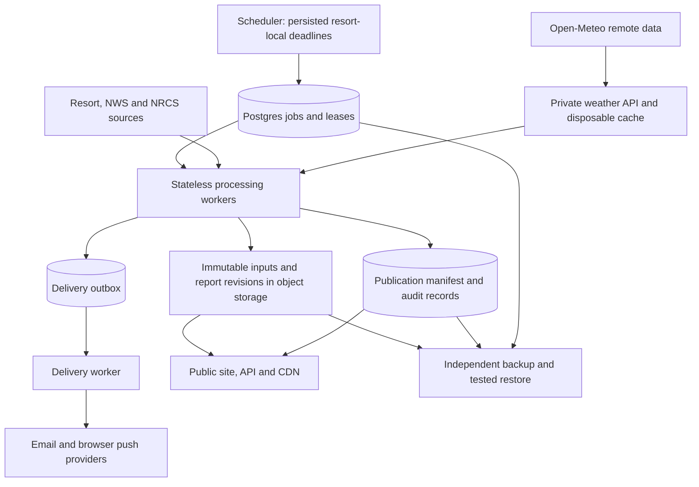

# 0xSnow Render architecture review

**Prepared by: Codex External Research Review Team**  
**Authorship: AI-generated research and code review, published at the repository owner’s request.**

**Reviewed November 18–19, 2026.** Repository: [main at 413056c](https://github.com/ysgjay/beaver-creek-grooming-bot/commit/413056ccf6a163ad4082d2107e50e28af2b21535).

## Verdict

**The direction is right, but this is an initial migration architecture—not yet a safely scalable, independently recoverable platform.** Keep the private weather API and background worker. Before increasing worker count or relying on Render as the sole publisher, fix job ownership, delivery recovery, configuration validation and backup/export coverage. Validate the weather server’s memory and cache size against the actual workload.

The most valuable ownership target is: **0xSnow can reproduce its reports, retain its history, control its processing, and restore elsewhere without depending on one vendor’s account or transient cache.** That does not require running every database, mail server or numerical weather model yourselves.

The user confirmed that the live Render setup is on a different account from the connected one. Consequently, this is a code/configuration review, checked against current official platform documentation. **Actual deployed settings, runtime metrics, costs, successful model responses and backup configuration were not available.** No deployment, environment variable, production data or repository source was changed.

## What the architecture actually does

The [Blueprint](https://github.com/ysgjay/beaver-creek-grooming-bot/blob/413056ccf6a163ad4082d2107e50e28af2b21535/render.yaml) declares:

| Component | Configuration | What it provides |
|---|---|---|
| `snow-meteo` | Private Open-Meteo 1.8.0 container, Oregon, Standard/2 GB memory, 40 GB disk, 30 GB remote block cache | Your own weather API process, reading Open-Meteo’s remote model data on demand. |
| `snow-worker` | Python background process, Oregon, Starter/512 MB memory, four threads, default shadow mode | Runs the existing resort pipeline without Vercel’s configured 60-second request limit. |
| Public site and APIs | Still Vercel | Interactive site, public reports, subscription/account routes and other API functions. |
| Public archive | Still Vercel Blob | Forecast/report JSON, maps, camera images and publication state. |
| Private database | Still Neon Postgres | Subscribers, notification claims, forecast audit calls/truth/weights. |
| Other scheduled jobs | Still Vercel | Observer, audit replay/export and fact checking. A backup daily pipeline trigger also remains. |
| Notification services | Resend, browser push services, optional ntfy | Delivery infrastructure remains external. |
| Weather inputs | Open-Meteo S3, public Open-Meteo history/previous-runs APIs, NWS, NRCS and resort sources | Upstream data and some processing remain external. |

The split between public reads and scheduled preparation is good: adding readers should mostly increase cached delivery, not rerun the weather pipeline. Moving expensive processing off a short-lived HTTP request is also sensible. The existing storage abstraction and per-resort context variables are useful foundations for portability and concurrent processing. [Worker](https://github.com/ysgjay/beaver-creek-grooming-bot/blob/413056ccf6a163ad4082d2107e50e28af2b21535/bcbot/worker.py), [storage](https://github.com/ysgjay/beaver-creek-grooming-bot/blob/413056ccf6a163ad4082d2107e50e28af2b21535/bcbot/store.py), [resort context configuration](https://github.com/ysgjay/beaver-creek-grooming-bot/blob/413056ccf6a163ad4082d2107e50e28af2b21535/bcbot/config.py).

I checked the pinned Open-Meteo release rather than assuming current documentation applied to an old image. **Version 1.8.0 supports `REMOTE_DATA_DIRECTORY` and the persistent block cache.** Its Docker image starts on `0.0.0.0:8080` and stores data under `/app/data`, consistent with the Blueprint. The private service and worker share a region, and the worker obtains the service hostname through a Blueprint reference. These are correct choices. [Pinned server configuration](https://github.com/open-meteo/open-meteo/blob/1.8.0/Sources/App/configure.swift), [pinned Dockerfile](https://github.com/open-meteo/open-meteo/blob/1.8.0/Dockerfile), [Render private networking](https://render.com/docs/private-network).

## Findings, in priority order

### 1. P1 — Live and shadow modes need enforced boundaries

**Verified in code and isolated probes:**

- In live mode, missing Blob credentials cause `get_store()` to select `LocalStore` rather than refuse startup. The worker has no persistent disk, so these writes are not a durable production archive and are not what the Vercel site reads.
- Shadow setup sets `STORE_MODE=shadow` and disables the main send flag, but does not remove or forbid database credentials. Every full run calls `audit.record()`, which checks only whether a database URL exists. If production credentials are copied in while the worker is still shadowing, it can write production audit records.
- `digest.run()` does not honor `SEND_ENABLED`. A live worker invokes it whenever its tick completes; with mail and database credentials present, the combined email path can send even when that flag is zero.

The setup notes instruct operators to leave credentials empty in shadow mode, which mitigates the second issue when followed. It is still an operational convention rather than a code-enforced boundary. [Storage fallback, lines 205–213](https://github.com/ysgjay/beaver-creek-grooming-bot/blob/413056ccf6a163ad4082d2107e50e28af2b21535/bcbot/store.py#L205), [shadow configuration, line 32](https://github.com/ysgjay/beaver-creek-grooming-bot/blob/413056ccf6a163ad4082d2107e50e28af2b21535/bcbot/worker.py#L32), [audit writes, line 215](https://github.com/ysgjay/beaver-creek-grooming-bot/blob/413056ccf6a163ad4082d2107e50e28af2b21535/bcbot/audit.py#L215), [digest gate, line 46](https://github.com/ysgjay/beaver-creek-grooming-bot/blob/413056ccf6a163ad4082d2107e50e28af2b21535/bcbot/digest.py#L46).

**Required change:** validate the intended role at startup. Live publishing must require durable storage and its coordination database. Shadow must have separate credentials or no production write capability, including audit writes. All notification paths must share the same explicit delivery gate. Keep shadow comparison outputs separate and export a compact comparison summary if they need to survive redeployment.

### 2. P1 — A send claim prevents repeats but does not recover failed delivery

The database inserts the once-per-day claim before contacting the email provider. The single-resort path subsequently marks the day sent even when a channel reports failure. The digest path permanently claims recipients before batching mail; if a later batch times out or fails, another invocation excludes those recipients. The provider request does not carry an idempotency key.

**Reproduced with an in-memory provider timeout:** the digest attempted delivery once, retained its claim after failure, and skipped the recipient on the next run. This is a code-path result, not a claim that a customer email was lost in production. [Single-resort delivery, line 229](https://github.com/ysgjay/beaver-creek-grooming-bot/blob/413056ccf6a163ad4082d2107e50e28af2b21535/bcbot/main.py#L229), [claim functions, line 196](https://github.com/ysgjay/beaver-creek-grooming-bot/blob/413056ccf6a163ad4082d2107e50e28af2b21535/bcbot/db.py#L196), [mailer](https://github.com/ysgjay/beaver-creek-grooming-bot/blob/413056ccf6a163ad4082d2107e50e28af2b21535/bcbot/mailer.py#L17).

**Required change:** use a durable delivery outbox with pending, leased, accepted, failed and terminal states; retries; provider message IDs; and a stable identity for each recipient/channel/report revision. Record provider acceptance separately from confirmed delivery. Resend supports idempotency keys for individual and batch sends, retained for 24 hours. Keep the application ledger longer, and handle ambiguous timeouts without blindly creating a new request identity. [Resend idempotency documentation](https://resend.com/docs/dashboard/emails/idempotency-keys).

### 3. P1 — Multiple workers would duplicate processing and race on shared state

The worker is a clock loop with a thread pool, not a distributed job consumer. Every instance calculates the same due resort list. `main.run()` reads and later overwrites Blob state, day records, latest records and month summaries without a shared processing lease. The daily-send claim covers only a notification decision; it does not protect forecast work or archive publication.

The deployment notes allow the Vercel backup trigger to remain. That creates another possible writer, even with only one Render worker. Normal worker replacement during deployments is another overlap scenario. A late-finishing old job can publish after a newer job. [Worker tick, line 45](https://github.com/ysgjay/beaver-creek-grooming-bot/blob/413056ccf6a163ad4082d2107e50e28af2b21535/bcbot/worker.py#L45), [pipeline](https://github.com/ysgjay/beaver-creek-grooming-bot/blob/413056ccf6a163ad4082d2107e50e28af2b21535/bcbot/main.py), [cutover notes](https://github.com/ysgjay/beaver-creek-grooming-bot/blob/413056ccf6a163ad4082d2107e50e28af2b21535/docs/RENDER.md).

**Required change:** begin with a database-backed job table and one active lease per resort/job type. Use unique job keys, lease expiry/renewal and an ownership token checked at publication so an expired worker cannot overwrite its successor. Separate immutable output creation from the short transaction that marks a revision current. A backup scheduler should enqueue the same idempotent jobs, not bypass their ownership rules.

Postgres is sufficient for the first version; adding Redis immediately is unnecessary. PostgreSQL explicitly documents `SKIP LOCKED` as useful for multiple consumers of queue-like tables. Acquire work in a short transaction, then use a durable lease during network processing rather than holding a row lock for minutes. [PostgreSQL locking documentation](https://www.postgresql.org/docs/current/sql-select.html#SQL-FOR-UPDATE-SHARE).

### 4. P1 — The $42 configuration is below the weather server’s documented sizing guidance

The selected weather plan provides **1 CPU / 2 GB RAM**. The pinned upstream guide specifies **at least 8 GB RAM**, recommends 16 GB, and suggests at least 100 GB storage for small/medium deployments. The worker separately has only 512 MB RAM while allowing four concurrent resort pipelines, including PDFs, images and ensemble arrays. [Pinned Open-Meteo guide](https://github.com/open-meteo/open-meteo/blob/1.8.0/docs/getting-started.md), [Render plan mapping](https://render.com/docs/compute-plans).

This does not prove the current small workload fails. It means the sizing is an unverified experiment, particularly with a cold cache or a growing set of models and locations. The **30 GB cache is a disk file, not a requirement for 30 GB of resident RAM**. Its working set, page faults and concurrent decompression still need measurement.

**Required change:** benchmark the exact deterministic, ensemble and three-elevation requests; capture peak memory, CPU, cold/warm latency, errors, cache hit rate and upstream bytes. Start worker concurrency conservatively and increase it only when both the worker and weather server have headroom. Compare a properly sized self-hosted service with the actual paid upstream plan covering ensembles/history before concluding that self-hosting is cheaper.

### 5. P1 — The cache is not ownership of a weather archive

`REMOTE_DATA_DIRECTORY` points to **Open-Meteo’s S3 bucket**. The server retrieves compressed blocks as needed and evicts older cached blocks. Fresh forecasts still depend on that upstream distribution. History and previous-runs calls explicitly remain on public Open-Meteo APIs. Vercel Blob remains the application archive, and Neon remains the private database. [Remote routing](https://github.com/ysgjay/beaver-creek-grooming-bot/blob/413056ccf6a163ad4082d2107e50e28af2b21535/bcbot/sources/openmeteo.py#L28), [upstream remote cache documentation](https://github.com/open-meteo/open-meteo/blob/main/docs/remote-data.md).

**Required change:** archive what 0xSnow actually needs to reproduce a published report: original extracted point/model inputs, issue/valid times, observation sources, units, selected forecast runs, transformation parameters, code/model version and final published revision. Store those as immutable objects under your account, with checksums and an independent backup/export path. A disposable weather cache should not be the only copy of any irreplaceable record.

For greater upstream independence later, synchronize selected regional/model datasets or run selected upstream downloaders. That is a separate ingestion operation with different storage, monitoring and maintenance costs. It is not necessary to ingest the entire global weather database merely to own your product’s evidence and history.

### 6. P2 — The weather service can look healthy while failing the useful workload

The startup check tests a small three-day, four-model forecast and logs its status. It does not prevent startup after failure or test the complete ensemble/elevation workload. The fallback accepts any HTTP success response before checking its contents, so an empty or incomplete HTTP 200 response can avoid fallback. This behavior was reproduced with a stubbed empty response.

Render’s private-service health check is TCP-only: an open port does not establish that model data is fresh or present. [Worker check](https://github.com/ysgjay/beaver-creek-grooming-bot/blob/413056ccf6a163ad4082d2107e50e28af2b21535/bcbot/worker.py#L73), [fallback code](https://github.com/ysgjay/beaver-creek-grooming-bot/blob/413056ccf6a163ad4082d2107e50e28af2b21535/bcbot/sources/openmeteo.py#L31), [Render health checks](https://render.com/docs/health-checks).

**Required change:** maintain an application-level freshness/capability check for each required model family; validate response coverage and non-null values; count which endpoint supplied each result. Add a circuit breaker and bounded fallback budget so a broken self-hosted service does not quietly shift the entire load onto the public API. Keep an appropriately provisioned upstream fallback if commercial usage requires it. Public API service terms are separate from the data license. [Open-Meteo terms](https://open-meteo.com/en/terms).

### 7. P2 — Scheduling and shutdown do not yet support broad geographic scale

The worker waits for an entire tick before checking the clock again. A long tick skips intervening scheduled minutes; there is no durable backlog or catch-up ledger. It has no explicit graceful shutdown handler. `--once` returns exit code zero even if every resort result is an error; an isolated probe confirmed this.

The copied UTC schedule concentrates five-minute checks around Mountain-time mornings. Individual resort date logic uses time zones correctly, but the outer schedule does not generate a local-time schedule for each resort. The digest explicitly uses `America/Denver`. These assumptions need review before US/Canada expansion. [Loop and exit status](https://github.com/ysgjay/beaver-creek-grooming-bot/blob/413056ccf6a163ad4082d2107e50e28af2b21535/bcbot/worker.py#L94), [digest time zone](https://github.com/ysgjay/beaver-creek-grooming-bot/blob/413056ccf6a163ad4082d2107e50e28af2b21535/bcbot/digest.py).

**Required change:** persist each job’s next due time, handle daylight-saving changes in the resort’s zone, prioritize publication deadlines and recover overdue work after restart. On termination, stop claiming new jobs and finish or release/checkpoint active ones within the configured shutdown period. A failed smoke run must exit nonzero. Use an external heartbeat and oldest-overdue-job alert so a dead worker can be detected independently of itself.

### 8. P2 — One disk-backed weather service has an availability ceiling

Render documents that a service with an attached disk cannot scale to multiple instances and loses zero-downtime deployment. The disk is not shared with another worker or service. This is acceptable for a rebuildable cache if stale-but-labeled reports and fallback behavior cover short outages. It is not a high-availability data store. [Render disk constraints](https://render.com/docs/disks#disk-limitations-and-considerations).

**Required change:** keep publication data outside the cache disk. Scale this service vertically first if measurement supports it. If availability later demands redundancy, use separately managed weather services with independent caches or a shared upstream object-data layer; account for duplicated cache capacity and cold starts. Do not put the subscriber database or sole archive copy on this same disk.

## Recommended target architecture

This diagram is a **proposed target**, not the current deployment. Job, publication, audit and outbox tables can share one managed Postgres database initially, with appropriate roles. They do not require four databases or four services. Start with one worker process that understands durable jobs; split processing and delivery into separate worker services when their load or deadlines justify it.

Keep Vercel’s frontend/CDN for now if it serves well. Keeping managed Postgres is also compatible with owning your data: require standard exports, tested restores and a documented migration path. Move Neon to Render Postgres only for a measured latency, cost, administration or backup advantage. Rehosting everything at once adds migration risk without automatically increasing control.

Use a storage interface that can target your current Blob archive and a portable object-storage backend. For a migration, copy and verify objects, compare manifests/checksums, briefly control the writer cutover, then redirect readers. Keep the previous copy until restore and rollback are proven. Private subscriber records and secrets must never be copied into the public archive.

## Cost and scale economics

The arithmetic in the repository’s **$42/month estimate is correct for the declared resources**. It is not an all-in production cost or a demonstrated capacity estimate.

| Illustrative configuration | Weather compute | Disk | Worker | Monthly subtotal |
|---|---:|---:|---:|---:|
| Current Blueprint: 2 GB weather server, 40 GB disk | $25 | $10 | $7 | **$42** |
| Upstream minimum-memory comparison: 8 GB / 2 CPU, 100 GB disk | $135 | $25 | $7 | **$167** |
| Upstream recommended-memory comparison: 16 GB / 2 CPU, 100 GB disk | $200 | $25 | $7 | **$232** |

These are comparisons, not automatic upgrade recommendations. A 2 GB worker instead of the $7 worker adds $18/month at the reviewed prices. A Pro workspace adds $25/month if selected. Database, object storage, backup, bandwidth, email, existing Vercel charges, paid upstream fallback and engineering time are additional. Actual workspace and billing configuration were not inspected. [Current Render pricing](https://render.com/pricing.md), [Open-Meteo sizing guidance](https://github.com/open-meteo/open-meteo/blob/1.8.0/docs/getting-started.md).

Measure costs by **resort, refresh, model set and delivery volume**. Viewer count should mainly affect CDN delivery when reports are prepared once and cached. A million page views should not imply a million fresh model calculations.

A simple processing bound is `ceil(due resorts / worker concurrency) × typical run duration`, before contention and retries. If a full resort run takes two minutes, 22 resorts with four threads take roughly 12 minutes; 100 take about 50 minutes. These are illustrative calculations, not measurements. More threads may only overload the same weather service or increase memory pressure. Track deadline completion and oldest queued job, not CPU alone.

For the initial operating model, a self-hosted API is most attractive when repeated requests share cached data and the workload is high enough to justify its fixed cost. Benchmark cold and warm operation. Do not assume moving API calls behind your own hostname removes the upstream data dependency or necessarily beats a managed API subscription.

## What “owning the data and processes” should mean here

| Goal | Present position | Completion criterion |
|---|---|---|
| Own application logic | Strong: code and Blueprint are in the repository. | Reproducible build, pinned image digest and dependency lock, documented configuration. |
| Control processing | Partial: main pipeline can run on Render; other jobs remain elsewhere. | All recurring jobs inventoried with one owner, durable scheduling, retry and monitoring. |
| Retain report evidence | Partial: daily objects exist but are overwritten and distributed across Blob/Neon. | Immutable input/report revisions, source/run metadata and correction history. |
| Recover from vendor/account loss | Not demonstrated in inspected code. | Independent encrypted exports, restore drill and documented credentials/DNS ownership. |
| Reduce upstream weather dependence | Partial: own API process, upstream remote data/cache misses and history APIs remain. | Retained selected inputs now; optional selected-model ingestion later. |
| Scale safely | Not yet established. | Competing workers cannot publish out of order or drop/repeat delivery; measured capacity meets deadlines. |

For backups, define a recovery point and recovery time for each asset. A starting policy could be daily private-database exports plus the database provider’s point-in-time recovery, continuous/versioned report objects, and a monthly restore drill into an isolated environment. Tighten the acceptable data-loss window for jobs and delivery records according to the service promise. Treat these as proposed targets, not existing guarantees. A restored delivery database can reintroduce previously completed jobs, so restoration needs a delivery reconciliation step before sending is enabled.

## Implementation order

1. **Before live cutover or added workers:** enforce live/shadow capabilities, honor the delivery gate everywhere, require durable storage/coordination, and make the one-shot smoke command report failures correctly.
2. **Before relying on retries or the backup scheduler:** add durable job leases, publication ownership checks and a delivery outbox with stable provider idempotency keys.
3. **Before accepting the scale/cost estimate:** test the actual model/ensemble/elevation workload under cold cache, concurrent requests and an upstream outage; right-size from those measurements.
4. **Before claiming independent recovery:** retain immutable point/model inputs and published revisions; export database and object data to an independent destination; successfully restore them.
5. **Then expand:** migrate observer, audit backfill/export and fact checking deliberately; replace Mountain-time-only scheduling assumptions; add worker replicas only after ownership tests pass. The current IndexNow helper also relies on `VERCEL_ENV=production`, so publication notifications need an explicit host-independent production setting during migration.

Do not switch off the old publisher until a controlled rehearsal proves the new one. During the transition, keep one active publisher or require both to use the same durable coordination mechanism. Preserving a backup trigger is useful only when it participates in that mechanism.

## Validation completed and remaining

Completed: reviewed the pinned Blueprint, worker, source adapter, storage, database claims, delivery paths, schedule and tests; verified the pinned upstream image’s remote-data support and filesystem layout; checked current Render networking, health, scaling, disk and pricing documentation; ran **six isolated probes** without network, database or delivery access. The [probe results](render-architecture-probes.json) capture the configuration, audit-isolation, failed-delivery, fallback and smoke-exit behaviors. These are targeted function checks, not a full application regression suite or production load test.

To finish validating the actual deployed system, obtain the live service plans, deployed commit/image digest, environment variable **names and relevant nonsecret mode values**, disk usage, peak memory/CPU, recent restart/error events, local-versus-fallback request counts, publication lag and backup status from the correct Render account. Do not export secret values. Then run controlled failure and restore tests in an isolated environment: kill a worker mid-job, race two workers, fail a mail batch, return incomplete weather data, interrupt the weather service and restore a report/database snapshot.

**Recommendation:** retain this architecture as the starting point. Invest first in durable coordination, recoverable delivery and independently retained data; use measurement to choose compute size. That will improve both cost control and self-sufficiency more than simply moving every service onto one Render server.
